# Educational Practice Mini-Project Report

## 1. Title Page

Project title: House Price Prediction Using Machine Learning

Academic group: BDA-2503

Team name: Zhaneliya

Project track: Machine Learning

Project topic: House price prediction

---

## 2. Team Members and Contributions

| No. | Full Name | Contribution |
|---|---|---|
| 1 | Beissekina Aneliya | Data preprocessing, GitHub management, Model Training, Testing |
| 2 | Iskakova Zhanet | Report, Data Visualization, EDA, Model evaluation |

---

## 3. Project Overview

The purpose of this project is to develop a machine learning system capable of predicting house prices using housing characteristics. The project includes data preprocessing, exploratory data analysis, feature engineering, model training, evaluation, and comparison of different machine learning algorithms.

The California Housing dataset was used to build predictive models. Two machine learning approaches were implemented and compared: Linear Regression and Random Forest Regression.

---

## 4. Problem Statement

Accurate house price prediction is an important task in the real estate industry. Buyers, sellers, and investors need reliable estimates of property values for decision-making.

The goal of this project is to build a machine learning model that predicts the median house value based on features such as:

- Location (longitude and latitude)
- Number of rooms
- Number of bedrooms
- Population
- Households
- Median income
- Ocean proximity

The project aims to determine which machine learning algorithm provides more accurate predictions.

---

## 5. Tools and Technologies

Development tools: GitHub, IntelliJ IDEA

Programming language: Python

Libraries: Pandas, NumPy, Seaborn, Matplotlib, Scikit-Learn

Framework: Scikit-learn

Dataset: California Housing Dataset

Machine Learning Models: Linear Regression, Random Forest Regressor

---

## 6. Main Features / Model Description

### Dataset

The dataset contains information about housing districts in California.

Initial dataset size:
- Rows: 20,640
- Columns: 10

### Data Preprocessing

The following preprocessing steps were performed:

1. Missing values in total_bedrooms were replaced with the median value.
2. New features were created:
    - Rooms per household
    - Bedrooms per room
    - Population per household
3. Categorical variable ocean_proximity was transformed using One-Hot Encoding.
4. Data was standardized using StandardScaler.
5. Dataset was split into:
    - Training set (80%)
    - Test set (20%)

### Models

**Linear Regression**

A baseline model used to establish initial prediction performance.

**Random Forest Regression**

An ensemble learning model that combines multiple decision trees to improve prediction accuracy and reduce overfitting.

### Prediction Task

Predict the target variable: `median_house_value`

---

## 7. Implementation Explanation

The project consists of several main stages:

**1. Data Loading**

The dataset is loaded from the CSV file using Pandas:

```python
df = pd.read_csv(os.path.join(base_dir, 'housing.csv'))
```

**2. Data Exploration**

The dataset structure, statistics, and missing values are analyzed using:

```python
df.head()
df.info()
df.describe()
```

**3. Feature Engineering**

Additional useful features are created:

```python
rooms_per_household
bedrooms_per_room
population_per_household
```

**4. Exploratory Data Analysis**

Several visualizations are generated:
- Histograms
- Correlation heatmap
- House price distribution

**5. Data Preparation**

The categorical feature is encoded and numerical features are scaled.

**6. Model Training**

Two models are trained:

```python
LinearRegression()
RandomForestRegressor()
```

**7. Model Evaluation**

The following metrics are calculated:
- MAE (Mean Absolute Error)
- RMSE (Root Mean Squared Error)
- R² Score

**8. Model Comparison**

The performance of both models is compared and the best-performing model is selected.

---

## 8. Screenshots

**Dataset Overview:**

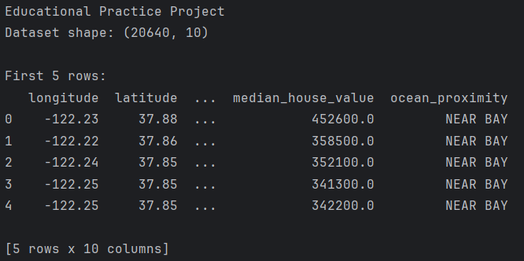

**Linear Regression Results:**

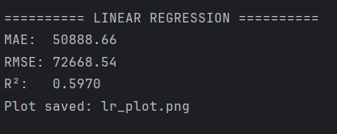

**Random Forest Results:**

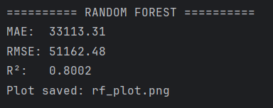

**Model Comparison:**

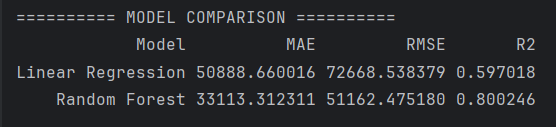

**Sample Predictions:**

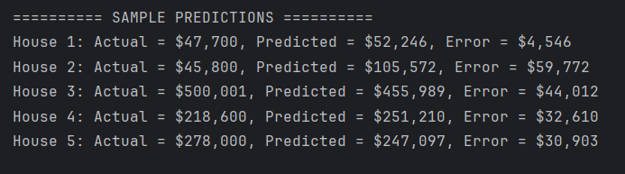

**Generated Visualizations:**

histograms.png:

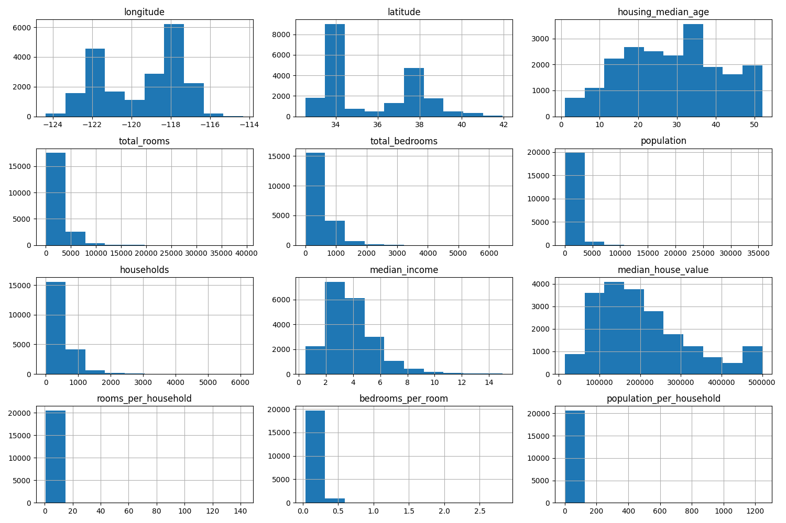

correlation_heatmap.png:

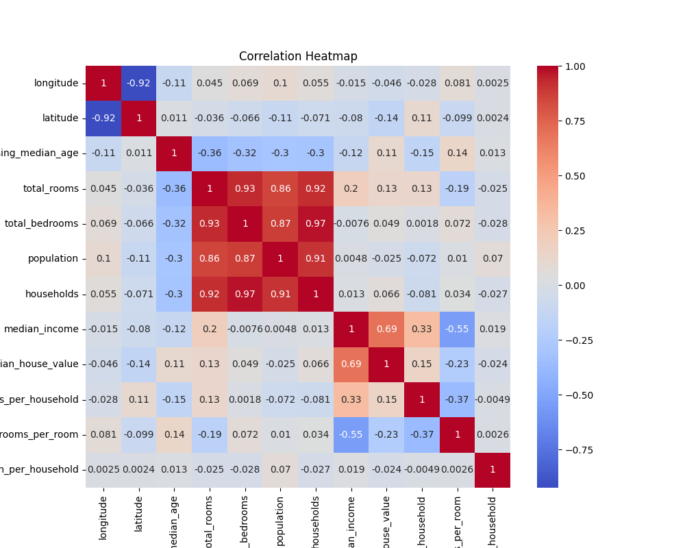

house_price_distribution.png:

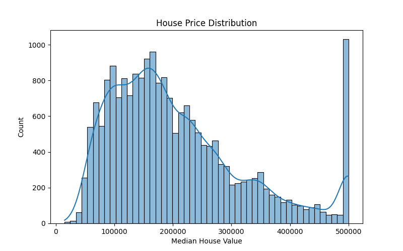

lr_plot.png:

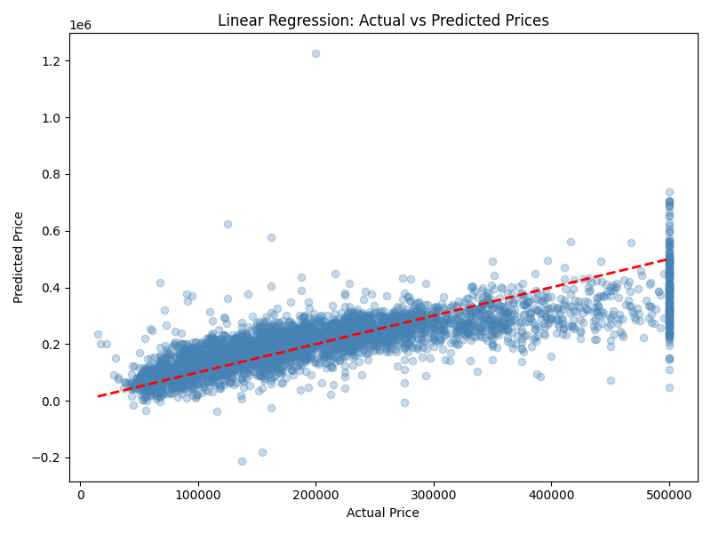

rf_plot.png:

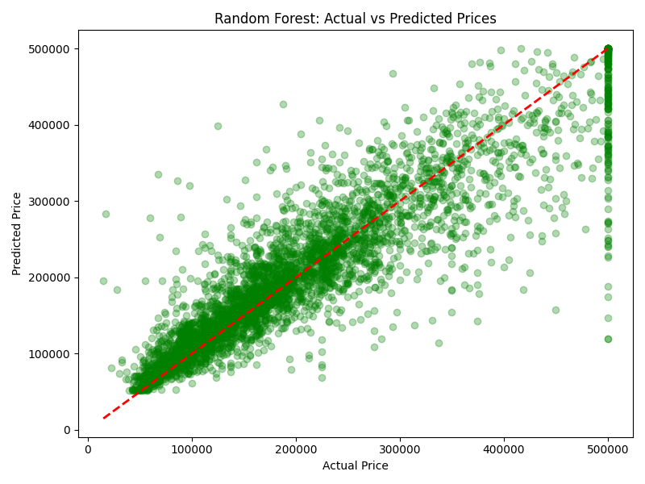

feature_importance.png:

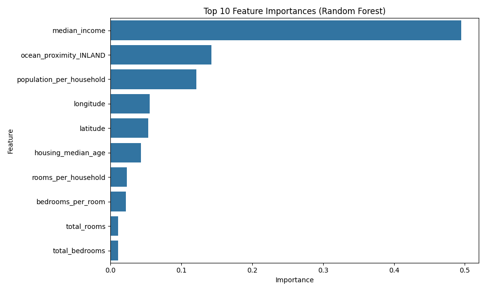

---

## 9. Testing or Evaluation Results

**Linear Regression**

| Metric | Value |
|---|---|
| MAE | 50,888.66 |
| RMSE | 72,668.54 |
| R² | 0.5970 |

**Random Forest**

| Metric | Value |
|---|---|
| MAE | 33,113.31 |
| RMSE | 51,162.48 |
| R² | 0.8002 |

**Comparison**

Random Forest achieved significantly better performance:
- MAE decreased from 50,889 to 33,113
- RMSE decreased from 72,669 to 51,162
- R² improved from 0.5970 to 0.8002

This indicates that Random Forest explains approximately 80% of the variance in house prices and provides more accurate predictions.
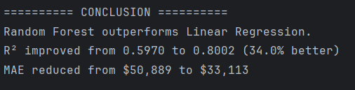

---

## 10. Difficulties and Solutions

**Difficulty 1: Raw Dataset Preparation**

The original California Housing dataset from Kaggle was not ready for machine learning training. It contained missing values and categorical features.

Solution: We cleaned the dataset, filled missing values in the total_bedrooms column using the median value, created additional features, and converted categorical variables using One-Hot Encoding.

**Difficulty 2: Train-Test Split**

Machine learning models require separate data for training and testing.

Solution: We manually divided the dataset into training (80%) and testing (20%) sets using Scikit-learn's train_test_split() function.

**Difficulty 3: Feature Scaling**

The numerical features had different ranges, which could negatively affect model performance.

Solution: We applied StandardScaler to normalize the data before training the models.

**Difficulty 4: Model Selection**

It was necessary to determine which machine learning algorithm produced better predictions.

Solution: We trained both Linear Regression and Random Forest models and compared their performance using MAE, RMSE, and R² metrics.

---

## 11. Conclusion

In this project, a machine learning system for house price prediction was successfully developed.

The dataset was cleaned, analyzed, and transformed through feature engineering and preprocessing techniques. Two machine learning models were trained and evaluated.

The results showed that Random Forest significantly outperformed Linear Regression:
- R² improved from 0.5970 to 0.8002
- Prediction error was substantially reduced
- More accurate house price estimates were obtained

Therefore, Random Forest was selected as the best model for this prediction task.

The project demonstrates the effectiveness of machine learning techniques for real estate price prediction and provides practical experience in data analysis, visualization, feature engineering, and model evaluation.

---

## 12. Links

GitHub repository link: https://github.com/aitu-educational-practice-2026/educational-practice-project-zhaneliya

Demo video link:
